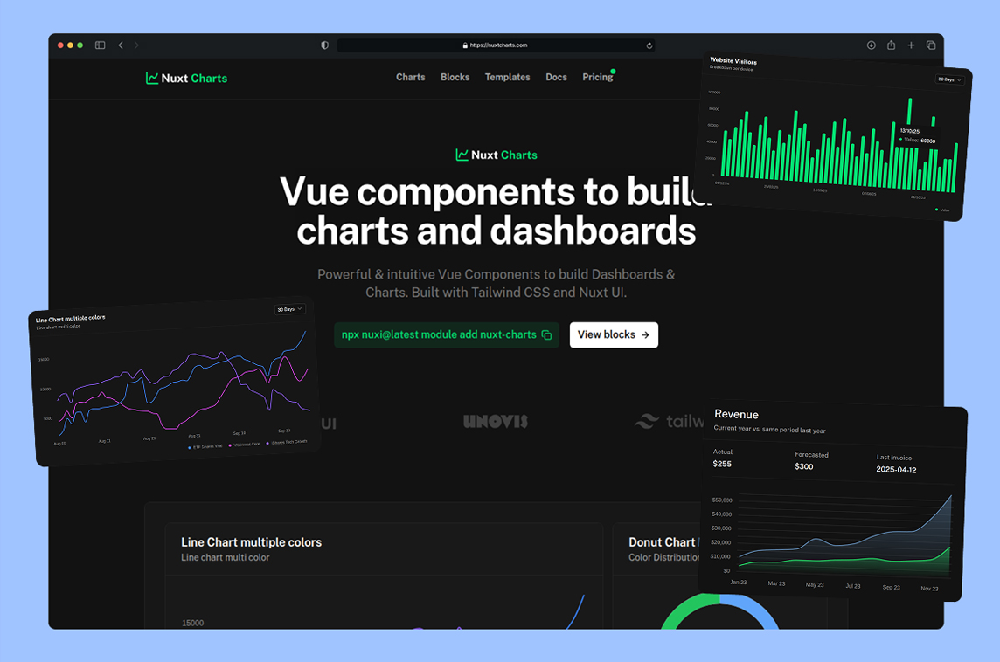

# vue-chrts

Chart and map components for Vue and Nuxt.



[Docs and examples](https://nuxtcharts.com/docs)

## Packages

| Package | npm | Engine | Status |
|---|---|---|---|
| [`packages/nuxt-charts-next`](packages/nuxt-charts-next) | `nuxt-charts` (3.x) | [vccs](https://vue-charts.com) + D3 | Current. Nuxt module, and plain Vue through `nuxt-charts/components` |
| [`packages/vue`](packages/vue) | `vue-chrts` (2.x) | [Unovis](https://unovis.dev) | Maintenance |
| [`packages/nuxt-charts`](packages/nuxt-charts) | `nuxt-charts@legacy` (2.x) | Unovis, through `vue-chrts` | Maintenance |

New projects should use `nuxt-charts` 3.x, with or without Nuxt.

## nuxt-charts 3

- 16 components: Area, Bar, Line, Donut, Bubble, Radar, Radial Bar, Funnel, Sankey, Candlestick, Status Tracker, Heatmap, Metric, Data, Dotted Map, TopoJSON Map
- Server-rendered SVG, resized to the container after hydration
- One peer dependency: `vue`. Nuxt, Nuxt UI and Tailwind are optional
- Themed with `--vc-*` CSS tokens; matches Nuxt UI and shadcn-vue tokens when present

### Nuxt

```bash
pnpm add nuxt-charts
```

```ts
export default defineNuxtConfig({
  modules: ["nuxt-charts"],
});
```

### Vue + Vite

```ts
import { LineChart } from "nuxt-charts/components";
import "nuxt-charts/theme.css";
import "nuxt-charts/components.css";
```

### Example

```vue
<script setup lang="ts">
const data = [
  { month: "Jan", sales: 100, profit: 50 },
  { month: "Feb", sales: 120, profit: 55 },
  { month: "Mar", sales: 180, profit: 80 },
];

const categories = {
  sales: { name: "Sales", color: "#3b82f6" },
  profit: { name: "Profit", color: "#10b981" },
};
</script>

<template>
  <LineChart :data="data" :categories="categories" x-axis="month" :height="300" />
</template>
```

See the [package README](packages/nuxt-charts-next/README.md) for every chart, server rendering and theming.

## Development

```bash
pnpm install
pnpm --filter nuxt-charts dev    # playground
pnpm --filter nuxt-charts test
```

## Angular

Looking for the Angular variant? See [Angular Charts](https://angularcharts.com/) or its [GitHub repo](https://github.com/dennisadriaans/angular-chrts).

## License

MIT
